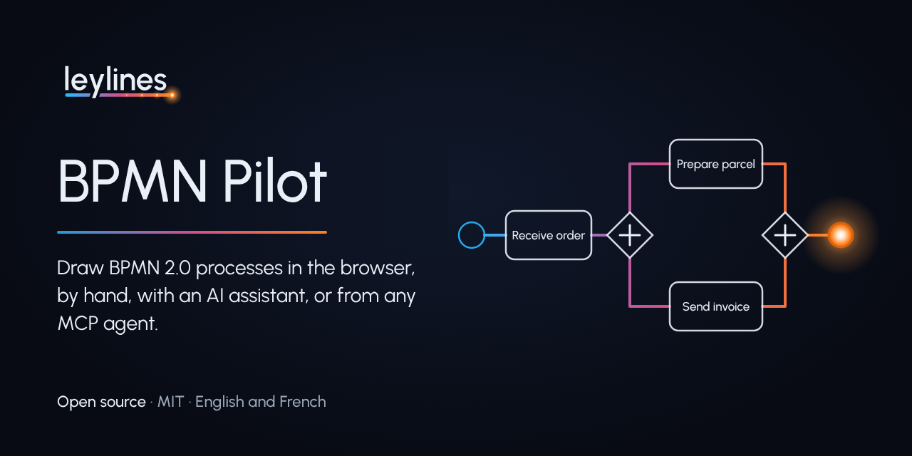
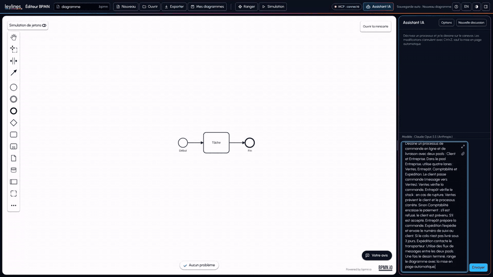

# BPMN-Pilot

[](https://github.com/Leylines-Prism/bpmn-pilot/actions/workflows/ci.yml)
[](https://github.com/Leylines-Prism/bpmn-pilot/tags)
[](https://github.com/Leylines-Prism/bpmn-pilot/pkgs/container/bpmn-pilot)
[](LICENSE)
[](https://scorecard.dev/viewer/?uri=github.com/Leylines-Prism/bpmn-pilot)
[](https://www.bestpractices.dev/projects/17089)

[English](README.md) | **Français**



**Modélisez tous les processus de votre contexte en quelques secondes, en quelques échanges avec votre
agent IA.** Relié à un agent et à tout ce qu'il connaît (messagerie, wiki, base documentaire, RAG,
mémoire en graphe ou « second cerveau »), BPMN-Pilot transforme de simples conversations en diagrammes
BPMN. Fini les heures passées à réfléchir à la structure BPMN et à dessiner à la main : l'agent trouve
les processus, l'éditeur les dessine et les vérifie, et vous relisez et ajustez le résultat. Une
relecture humaine reste nécessaire, mais le travail va beaucoup plus vite. C'est la version Docker, où
tout agent MCP pilote l'éditeur. La version en ligne suit la même idée avec son assistant intégré :
décrivez un processus ou joignez vos documents (Word, Excel, PDF, e-mails…), et il le dessine. La même
conversation met aussi le schéma en forme : couleurs de fond, de contour et de texte, gras, italique,
souligné, taille et police, mais aussi noms et types des éléments, sur autant d'éléments à la fois que
vous voulez (« mets toutes les tâches manuelles en orange, texte en gras »). Chaque réponse s'annule
d'un clic.

BPMN-Pilot est un éditeur BPMN 2.0 dans le navigateur (bpmn-js). Utilisez-le
[en ligne](https://bpmn.leylines.fr), avec un simple navigateur, ou faites-le tourner sur votre propre
machine avec Docker.

- **Dessinez à la main**, avec le modeleur bpmn-js et ses extensions.
- **Demandez à l'assistant IA** : il dessine les processus que vous décrivez, dans l'onglet ouvert.
- **Connectez un agent par MCP** (version Docker), comme Claude Code.

> [!TIP]
> **La version en ligne s'utilise telle quelle, sans risque.** Le lien public (https://bpmn.leylines.fr)
> n'est que des fichiers statiques servis par GitHub Pages : aucun serveur applicatif, aucun compte,
> aucune base de données derrière.
>
> - **Vos diagrammes restent dans votre navigateur.** Ils sont enregistrés dans le stockage du
>   navigateur, et les fichiers que vous ouvrez ou téléchargez ne quittent jamais votre ordinateur.
> - **Vos clés API aussi.** Elles ne sont envoyées qu'au fournisseur d'IA que vous avez choisi,
>   directement depuis votre navigateur, jamais à un serveur de ce projet.
> - **Quand vous utilisez l'assistant**, votre message et le diagramme partent directement chez ce
>   fournisseur, selon ses propres conditions. Aucun intermédiaire.
> - **La seule autre requête** est une mesure d'audience sans cookie, qui ne contient jamais de
>   diagramme, de message ni de clé.
>
> Utilisez tout de même toujours une clé API créée pour cet éditeur seul, avec une durée de validité
> limitée et une limite de dépense. Détails, limites et moyen de le vérifier vous-même :
> [Vos données et vos clés API dans la version en ligne](docs/online-privacy.fr.md).

La connexion MCP va plus loin que le dessin à l'écran. Un agent apporte sa propre mémoire et son contexte,
avec tout ce à quoi il est connecté, et intègre des diagrammes BPMN à ses propres workflows :

- il charge un diagramme en XML BPMN, ou le dessine ;
- il le vérifie selon les règles BPMN ;
- il le récupère en XML BPMN ou en image PNG, ou l'exporte en fichier BPMN, SVG, PNG ou PDF dans le dossier
  exports du serveur, pour l'étape suivante : un document, un ticket, un dépôt.

Les outils s'exécutent dans un onglet de l'éditeur, qui doit seulement rester ouvert.

> [!WARNING]
> **Version Docker seulement : pas faite pour être exposée sur internet, par conception.** Cela
> concerne votre propre copie, pas la version en ligne ci-dessus. La version Docker est prévue pour
> votre propre machine ou un réseau privé, elle n'a donc pas de connexion. Le risque reste limité,
> mais la publier revient à ouvrir à tous un service sans authentification : vos clés API peuvent
> être utilisées ou volées, et les diagrammes stockés dans le conteneur (les fichiers BPMN de « Mes
> diagrammes ») peuvent être lus ou supprimés. Par défaut, elle ne répond que sur cette machine
> (`127.0.0.1`). Si vous la mettez quand même sur internet, c'est à vos propres risques.

## Le lancer avec Docker

Il faut [Docker](https://docs.docker.com/get-docker/) avec Docker Compose. Deux images sont publiées
sur le GitHub Container Registry, pour amd64 et arm64 :

- `ghcr.io/leylines-prism/bpmn-pilot` : l'éditeur.
- `ghcr.io/leylines-prism/bpmn-pilot-mcp` : son serveur (assistant IA, MCP pour les agents,
  « Mes diagrammes »).

### En ligne de commande

```
mkdir bpmn-pilot && cd bpmn-pilot
curl -fsSLO https://raw.githubusercontent.com/Leylines-Prism/bpmn-pilot/main/docker-compose.image.yml
docker compose -f docker-compose.image.yml up -d
```

Puis ouvrir http://localhost:8080. Sans `curl`, `wget https://raw.githubusercontent.com/Leylines-Prism/bpmn-pilot/main/docker-compose.image.yml` fait la même chose.

- **Assistant IA** : créez un fichier `.env` dans le même dossier avec votre clé API (Anthropic,
  OpenAI, Mistral, ou un Ollama local), par exemple `ANTHROPIC_API_KEY=sk-ant-...`, puis relancez la
  commande `up -d`. Toutes les variables sont listées dans [mcp/.env.example](mcp/.env.example).
  Une clé peut aussi se saisir dans la fenêtre Options de l'assistant. Sans clé, l'éditeur marche ;
  seul l'assistant est éteint.
- **Vos fichiers** (Mes diagrammes sur le serveur, exports) sont dans le dossier `bpmn-data`, à côté
  de `docker-compose.image.yml` : voir [Vos fichiers](#vos-fichiers-version-docker).
- **Page vitrine** : le logo de la barre d'outils ouvre une page vitrine, avec le logo et les fonds
  d'écran de l'auteur. Pour la couper, ajoutez `SHOWCASE=off` au fichier `.env` (ou aux variables
  d'environnement de la pile), puis relancez la commande `up -d`. Le logo ouvre alors la fenêtre
  « Votre avis ».
- **Mise à jour** : téléchargez de nouveau `docker-compose.image.yml` avec la même commande `curl`,
  pour avoir aussi les nouveaux services et réglages (votre fichier `.env` et le dossier `bpmn-data`
  restent tels quels). Pour rester sur une version donnée, changez plutôt le numéro de version des
  trois lignes d'image (voir les [versions](https://github.com/Leylines-Prism/bpmn-pilot/tags)). Puis :

  ```
  docker compose -f docker-compose.image.yml pull
  docker compose -f docker-compose.image.yml up -d
  ```

### Avec un gestionnaire de conteneurs

Dans un outil qui déploie des piles Compose (Portainer, par exemple), créez une pile, collez-y le
contenu de [docker-compose.image.yml](docker-compose.image.yml), et saisissez les réglages ci-dessous
(`ANTHROPIC_API_KEY`…) comme variables d'environnement de la pile. Réglez `BPMN_DATA_DIR` sur un chemin
absolu de la machine hôte : le dossier où vous retrouverez vos fichiers.

### Depuis le code source

Pour modifier le code, ou construire les images vous-même :

```
git clone https://github.com/Leylines-Prism/bpmn-pilot.git
cd bpmn-pilot
docker compose up -d --build
```

Les clés API vont alors dans `mcp/.env` (copie de `mcp/.env.example`), les autres réglages dans
un fichier `.env` à côté de `docker-compose.yml`. **Mise à jour** : `git pull`, puis
`docker compose up -d --build`.

## Vos fichiers (version Docker)

Tout ce que garde le serveur est dans un seul dossier, `bpmn-data`, à côté du fichier compose.
Ouvrez-le avec votre explorateur de fichiers pour récupérer vos fichiers :

- `bpmn-data/diagrams` : les diagrammes enregistrés sur le serveur avec « Mes diagrammes », un
  fichier `.bpmn` par diagramme, à son nom (`Mon processus.bpmn`). Renommer un diagramme dans
  l'éditeur renomme son fichier. Deux diagrammes de même nom donnent `Mon processus.bpmn` et
  `Mon processus (2).bpmn`. Le fichier caché `.index.json` relie les fichiers à l'éditeur : laissez-le
  en place. Un fichier `.bpmn` copié dans ce dossier apparaît dans Mes diagrammes, sous son nom de
  fichier (10 Mo au plus).
- `bpmn-data/exports` : les exports (.bpmn, .xml, SVG, PNG, PDF), quand la **Destination** en haut du
  menu Exporter est « Serveur » ou « Les deux ». « Téléchargement », le choix par défaut, les télécharge
  seulement dans le navigateur, comme avant. Un export ne remplace jamais un fichier : un deuxième `Mon processus.pdf`
  devient `Mon processus (2).pdf`. « Code XML à copier » et « Imprimer » ne créent pas de fichier et
  ne sont pas concernés.

Où est le dossier :

- Il est créé au premier démarrage, à côté du fichier compose, sous Docker Desktop (Windows, macOS)
  comme sous Linux. Un court service `data-init` le prépare avant le serveur (crée `diagrams/` et
  `exports/`, les donne à l'utilisateur du serveur), puis s'arrête : son état « Exited (0) » est
  normal.
- **Linux** : le serveur tourne sous l'utilisateur 1000, sans root, pour que les fichiers vous
  appartiennent. Si `id -u` et `id -g` donnent d'autres nombres, ajoutez `PUID=` et `PGID=` avec ces
  nombres au fichier `.env`. Si le serveur ne peut toujours pas écrire dans le dossier, il le dit dans
  son journal au démarrage (`docker compose logs mcp`) et dans l'erreur de l'export, avec le dossier
  en cause.
- **Ailleurs** : réglez `BPMN_DATA_DIR` sur le chemin d'un autre dossier. Dans un outil de gestion de
  conteneurs, donnez toujours un chemin absolu, et collez le dernier `docker-compose.image.yml` : une
  copie plus ancienne n'a pas le service `data-init`.
- **SELinux** (Fedora, RHEL…) : si l'accès est refusé au serveur malgré le bon propriétaire, ajoutez
  `:z` après le montage (`${BPMN_DATA_DIR:-./bpmn-data}:/data:z`), seulement pour un dossier réservé à
  BPMN Pilot.

Sécurité : les fichiers ne sont lisibles que par leur propriétaire et son groupe (0640, dossiers 0750).
Le serveur tourne sur un système de fichiers en lecture seule, sauf ce dossier, sans aucune capacité
Linux et sans élévation de privilèges. Il n'accepte que les cinq formats d'export, vérifie que chaque
fichier correspond à son format, prend 20 Mo au plus par export et nettoie les noms de fichiers (pas
de dossier, pas de fichier caché, pas de nom réservé par Windows).

## En cas de problème (version Docker)

- **Le journal du serveur** dit ce qu'il ne peut pas faire au démarrage :
  `docker compose -f docker-compose.image.yml logs mcp` (sans `-f …` depuis le code source, ou le
  journal du conteneur dans votre outil de gestion de conteneurs).
- **Un export vers le serveur, ou un enregistrement dans Mes diagrammes, échoue** : le serveur ne
  peut pas écrire dans son dossier de données, et l'erreur le nomme. Le service `data-init` prépare ce
  dossier à chaque démarrage ; si l'erreur reste, le dossier appartient à un autre utilisateur que
  `PUID`:`PGID` (1000:1000 par défaut).
- **Un agent reçoit une erreur 401 « MCP is closed »** : l'éditeur est servi sous un autre nom que
  localhost sans `MCP_TOKEN`. Réglez le jeton (voir [Le joindre depuis d'autres machines](#le-joindre-depuis-dautres-machines)).
- **Que sait faire mon modèle ?** `docker compose -f docker-compose.image.yml exec mcp node mcp/check-providers.js`
  essaie chaque modèle réglé sur le serveur avec de vrais appels : réponse, appel d'outil, image, PDF.
  Elle distingue une erreur de réglage (clé, adresse, nom du modèle, refus du fournisseur) d'une limite
  du modèle (pas d'appel d'outil, pas de vision, pas de PDF), pour quelques centaines de jetons par
  modèle. Elle ne couvre pas les fournisseurs saisis dans la fenêtre Options, qui restent dans le navigateur.

## Fournisseurs d'IA : vos essais sont les bienvenus

Anthropic (Claude Opus, Sonnet et Haiku 5.5) est vérifié avec de vrais appels : réponse, appels
d'outils, images et PDF. OpenAI, Mistral, xAI, Ollama et les serveurs compatibles OpenAI suivent leurs
API publiées, mais les mainteneurs n'ont pas de clé pour les vérifier. Si vous en utilisez un, un court
retour aide beaucoup : lancez la commande de vérification (voir [En cas de problème](#en-cas-de-problème-version-docker)),
puis ouvrez une issue avec le formulaire [AI provider test report](https://github.com/Leylines-Prism/bpmn-pilot/issues/new?template=provider_test.yml).
Ne collez jamais de clé.

## Le joindre depuis d'autres machines

Le conteneur sert du HTTP simple sur `127.0.0.1:8080`, pour cette machine seulement. Pour l'utiliser
depuis vos autres appareils, gardez-le sur un réseau privé : [Tailscale Serve](https://tailscale.com/kb/1312/serve),
par exemple, lui donne une adresse HTTPS que seules les machines de votre tailnet peuvent joindre.
Donnez ensuite son nouveau nom à l'éditeur, dans le fichier `.env` à côté du fichier Compose, et
ajoutez un jeton `MCP_TOKEN=...` (la fenêtre « Connecter un agent » en génère un ; depuis le code
source, il va dans `mcp/.env`). Le jeton est obligatoire ici : dès que `MCP_ALLOWED_HOSTS` contient un
autre nom que localhost, `/mcp` répond 401 tant que `MCP_TOKEN` n'est pas réglé. `MCP_AUTH=off`
l'ouvre sans jeton, pour un réseau de confiance ou derrière un proxy qui authentifie déjà `/mcp` :

```
BPMN_EDITOR_ORIGINS=https://bpmn.example.com
MCP_ALLOWED_HOSTS=bpmn.example.com
```

Relancez `docker compose up -d`. D'autres proxys marchent aussi : ils doivent transmettre l'en-tête
`Host` et accepter le WebSocket sur `/bridge` (détails dans
[mcp/README.fr.md](mcp/README.fr.md#derrière-un-nom-de-domaine)).

### Sur internet, à vos propres risques

Ce projet n'est ni conçu ni testé pour être exposé sur internet, et n'offre aucune garantie si vous
le faites. Si vous le choisissez quand même, placez une connexion devant les pages et réglez le
jeton. Voici un exemple avec [Caddy](https://caddyserver.com/), qui obtient tout seul le certificat
de votre domaine. Faites pointer le DNS du domaine vers la machine, réglez les deux variables et le
jeton ci-dessus, puis utilisez ce `Caddyfile` :

```
bpmn.example.com {
	# Une connexion pour les pages. /mcp en est exclu : les agents utilisent MCP_TOKEN.
	@pages not path /mcp
	basic_auth @pages {
		alice <empreinte donnée par : caddy hash-password>
	}
	reverse_proxy 127.0.0.1:8080
}
```

Sans connexion au proxy, quiconque trouve l'adresse peut utiliser l'éditeur et vos clés API. Une
connexion et un jeton réduisent le risque, ils ne le suppriment pas. [Cloudflare Tunnel](https://developers.cloudflare.com/cloudflare-one/connections/connect-networks/)
avec Cloudflare Access est une autre façon de placer une connexion devant, sans port ouvert.

## Connecter un agent (MCP)

Cliquez sur le badge **MCP** de la barre d'outils. La fenêtre « Connecter un agent » donne l'adresse à
utiliser (`http://localhost:8080/mcp`, ou `https://votre-domaine/mcp`), et le réglage à coller pour
Claude Code, Claude Desktop, GitHub Copilot dans VS Code, Cursor ou un autre client MCP. L'agent dessine dans le dernier onglet de l'éditeur
utilisé : gardez-le ouvert.

Un jeton protège cet accès : la même fenêtre en génère un et dit où le mettre. Il est facultatif
sur `localhost`, et obligatoire dès que l'éditeur est servi sous un autre nom (voir
[Le joindre depuis d'autres machines](#le-joindre-depuis-dautres-machines)). Sans lui, la fenêtre
indique que MCP est fermé, et l'agent reçoit une erreur 401 qui nomme `MCP_TOKEN`.

## Où sont gardées vos clés API

**Dans la version Docker**, le plus sûr est le serveur : le fichier `.env` à côté de
`docker-compose.image.yml` (ou `mcp/.env` depuis le code source). La clé reste sur le serveur et
n'arrive jamais au navigateur. Une clé saisie dans la fenêtre Options de l'assistant est gardée dans le
navigateur comme ci-dessous, puis envoyée à chaque message à votre serveur, qui la transmet au
fournisseur sans l'enregistrer.

**Dans le navigateur** (la version en ligne, ou les clés saisies dans Options) :

- La clé reste dans votre navigateur, pour ce site seulement. Les autres sites ne peuvent pas la lire.
- « Se souvenir des clés API sur votre appareil » décoché (par défaut) : la clé est gardée dans le
  `sessionStorage` et disparaît à la fermeture de l'onglet.
- Coché : la clé est gardée dans le `localStorage` et reste sur l'appareil jusqu'au clic sur
  « Effacer les clés API ».
- Elle n'est pas chiffrée. La chiffrer dans le navigateur ne servirait à rien : la clé pour la
  déchiffrer devrait être rangée juste à côté.
- Ce qui la protège : la page n'exécute aucun script venu d'un autre site (politique de sécurité du
  contenu, CSP), et la clé ne part que vers le fournisseur choisi.
- La limite : une extension de navigateur malveillante, ou quelqu'un qui utilise votre session sur
  l'ordinateur, peut la lire. Sur un ordinateur partagé, laissez la case décochée.

## Réglages

Tous facultatifs. Avec les images publiées, mettez-les tous dans le fichier `.env` à côté de
`docker-compose.image.yml`, ou dans les variables d'environnement de la pile, puis relancez la
commande `up -d`. Depuis le code source, mettez-les dans un fichier `.env` à côté de
`docker-compose.yml` (git l'ignore), sauf si le tableau indique `mcp/.env`, puis lancez
`docker compose up -d --build`.

| Réglage | Rôle |
|---|---|
| `MISTRAL_API_KEY`, `ANTHROPIC_API_KEY`, `OPENAI_API_KEY`… (`mcp/.env`) | Clés API de l'assistant IA. Voir `mcp/.env.example`. |
| `MCP_TOKEN` (`mcp/.env`) | Jeton que les agents doivent envoyer. La fenêtre « Connecter un agent » en génère un. Obligatoire quand `MCP_ALLOWED_HOSTS` contient un autre nom que localhost. |
| `MCP_AUTH` (`mcp/.env`) | `off` ouvre `/mcp` sans jeton sous un autre nom que localhost. Seulement sur un réseau de confiance, ou derrière un proxy qui authentifie `/mcp`. |
| `BPMN_PORT` | Port du site (8080 par défaut). |
| `BPMN_EDITOR_ORIGINS`, `MCP_ALLOWED_HOSTS` | L'adresse et le nom du site quand il est servi sous un nom de domaine (voir plus haut). |
| `BPMN_BIND` | Interface réseau où le site écoute (`127.0.0.1` par défaut). `0.0.0.0` l'ouvre à votre réseau, sans HTTPS. |
| `BPMN_DATA_DIR` | Dossier des fichiers du serveur, Mes diagrammes et exports (`./bpmn-data` par défaut). Dans un outil de gestion de conteneurs, un chemin absolu. |
| `PUID`, `PGID` | Utilisateur et groupe du serveur, propriétaires du dossier de données (1000 par défaut). |
| `PUID`, `PGID` | Utilisateur et groupe du serveur, propriétaires de ses fichiers (1000 par défaut). |
| `SHOWCASE` | `off` coupe la page vitrine (`about.html`) et ses fonds d'écran. Le logo de la barre d'outils ouvre alors la fenêtre « Votre avis ». `on` par défaut. |

## Ce que fait l'éditeur

- **Fichiers** : nom, nouveau, ouvrir (fichier, XML collé, ou glisser-déposer), exporter (.bpmn,
  .xml, SVG, PNG, PDF), copier en image, imprimer le diagramme seul, sur une page. Le diagramme en
  cours est restauré quand vous revenez.
- **Mes diagrammes** : enregistrer plusieurs diagrammes, les rouvrir, renommer, supprimer. Ctrl+S
  enregistre.
- **Dessin** : palette, menu contextuel, copier-coller, boutons Annuler et Rétablir, rangement,
  simulation de jetons, vérification des règles BPMN, grille, mini-carte, et le panneau Processus
  pour les propriétés de chaque élément.
- **Carte de chaleur et rapport de processus** : pendant la simulation, colorer le diagramme selon
  le nombre de jetons passés par chaque élément, joués à la main ou calculés d'après les
  probabilités des branches. Exporter un rapport de processus (PDF ou Markdown) : constats en trois
  niveaux, axes d'amélioration, séquence des éléments.
- **Comparer** : deux versions côte à côte, avec en couleur ce qui a été ajouté, supprimé ou modifié,
  et la liste des différences, depuis un fichier .bpmn ou depuis l'avant de la réponse de l'IA.
- **Couleurs et texte** : n'importe quelle couleur de fond, de contour ou de texte, dans des palettes
  toutes prêtes ou le sélecteur de couleur du système, et la mise en forme du texte (gras, italique,
  souligné, taille, police, « Auto » pour un texte lisible sur les fonds sombres). Le panneau
  Processus copie un style sur d'autres éléments et reprend d'un clic ceux déjà dans le diagramme.
- **Assistant IA** : décrivez un processus et il le dessine, dans votre langue. Vous pouvez coller ou
  déposer des images, des PDF, des documents bureautiques (Word, Excel, PowerPoint, OpenDocument) et
  des fichiers texte (CSV, JSON, XML, Markdown…), dont le texte est lu dans le navigateur. Le modèle se choisit dans Options. Ce qu'il ajoute ou modifie est
  entouré sur le canevas, une pilule résume les changements, et un clic montre l'avant et l'après ou
  annule toute la réponse.
- **Interface** : thème clair ou sombre, anglais ou français, panneaux latéraux redimensionnables.
  Pensé pour un écran d'ordinateur : sur un téléphone, il sert surtout à regarder un diagramme.

## En quoi il diffère de draw.io ou Lucidchart

Ils sont très bien pour dessiner à peu près tout, à plusieurs. Cet éditeur ne fait que du BPMN 2.0,
sur la base de [bpmn-js](https://github.com/bpmn-io/bpmn-js) : un diagramme y est un vrai modèle
BPMN, le fichier .bpmn s'ouvre donc dans d'autres outils BPMN, se vérifie et se simule, et ce que
dessine l'IA est aussi du BPMN valide. En revanche, pas de collaboration en temps réel, de lien de
partage ni de modèles.

## L'utiliser en ligne

L'éditeur est ouvert à tous sur https://bpmn.leylines.fr (GitHub Pages) : sans compte, sans
installation, juste un navigateur. Son [guide d'utilisation](https://bpmn.leylines.fr/aide.html)
explique comment dessiner, enregistrer, exporter et se servir de l'assistant IA. Le bouton Aide (?) de
la barre d'outils l'ouvre aussi.

Il suit les versions publiées (le dernier tag `vX.Y.Z`) et affiche sa version en bas à gauche
du canevas et du guide d'utilisation.

Pour l'assistant IA, chaque visiteur saisit sa propre clé API, qui reste dans son navigateur. Par
rapport à la version Docker, pas de connexion d'agent (MCP), pas d'enregistrement sur un serveur, et
certains fournisseurs (OpenAI) refusent les appels depuis une page web. Le lien « Confidentialité » de la page
dit ce qui sort du navigateur, et
[Vos données et vos clés API dans la version en ligne](docs/online-privacy.fr.md) donne le détail.

La page stable mesure son audience de façon anonyme, sans cookie :
visites, provenance et quelques actions (assistant ouvert ou utilisé, fournisseur connecté, diagramme
créé, ouvert ou exporté, temps actif par tranche, clic sur le lien de soutien). Aucun script tiers n'est chargé : la page envoie
elle-même ces mesures ([src/analytics.js](src/analytics.js)), jamais le contenu des diagrammes, des
messages ni les clés API. « Do Not Track » et « Global Privacy Control » coupent la mesure, et un
indicateur dans le stockage du navigateur exclut vos propres visites (voir [src/analytics.js](src/analytics.js)). Ni l'image
Docker ni `npm run dev` ne mesurent quoi que ce soit. La mesure est configurée conformément aux recommandations de la
CNIL pour les mesures d'audience exemptées de consentement.

## Développement

`npm install`, puis `npm run dev` pour l'éditeur, et `npm start` dans `mcp/` pour le serveur.
Détails sur le serveur, l'assistant et les outils MCP : [mcp/README.fr.md](mcp/README.fr.md).
`npm run build:online` construit la version en ligne en site statique dans `dist-online/` (`BASE_PATH` règle son
chemin). La mesure d'audience s'active avec les variables GitHub `VITE_UMAMI_URL` (adresse
du service de mesure) et `VITE_UMAMI_WEBSITE_ID` (identifiant du site) : sans elles, rien n'est envoyé. Le site est publié par [.github/workflows/pages.yml](.github/workflows/pages.yml) à chaque
changement sur `main`.

## À propos du projet

C'est un projet personnel, maintenu sur le temps libre, et **toutes les contributions sont les
bienvenues** : signalements de bugs, idées, traductions, documentation ou code. Si vous avez envie de
le faire grandir, n'hésitez pas.

En toute transparence : son auteur n'est pas développeur professionnel. Le développement de
l'éditeur est assisté par IA, avec Claude Code et d'autres modèles, et chaque changement est essayé
dans le navigateur avant d'être publié. Les relectures de développeurs expérimentés sont particulièrement
appréciées.

**Testeurs recherchés pour les fournisseurs d'IA.** L'assistant est essayé au quotidien avec les
modèles Anthropic seulement. OpenAI, Mistral, xAI (Grok), Ollama et les serveurs compatibles OpenAI sont pris en
charge d'après leur documentation, mais rarement essayés pour de vrai. Si vous utilisez l'un d'eux,
tout retour aide, que ça marche ou non : ouvrez une [issue](https://github.com/Leylines-Prism/bpmn-pilot/issues)
ou une [discussion](https://github.com/Leylines-Prism/bpmn-pilot/discussions) avec le fournisseur,
le modèle et ce que vous avez essayé (dessin, images, PDF).

Commencez par [CONTRIBUTING.md](CONTRIBUTING.md) (en anglais). Les questions et les idées vont dans
les [Discussions](https://github.com/Leylines-Prism/bpmn-pilot/discussions), les bugs dans les
[issues](https://github.com/Leylines-Prism/bpmn-pilot/issues), et les failles de sécurité passent
par le formulaire privé décrit dans [SECURITY.md](SECURITY.md). Pas de délai de réponse garanti,
mais tout est lu.

Si l'éditeur vous rend service, vous pouvez soutenir le projet en offrant un café sur
[Ko-fi](https://ko-fi.com/leylines_prism).

## Licence

Le code est publié sous la [licence MIT](LICENSE).

Le nom, le logo et les éléments de marque Leylines (les fichiers de [src/brand/](src/brand/)
et le logo dessiné par [src/theme/brand-logo.js](src/theme/brand-logo.js)) ne sont pas couverts
par cette licence. Si vous publiez votre propre version, remplacez-les par les vôtres.

L'éditeur repose sur [bpmn-js](https://github.com/bpmn-io/bpmn-js), dont la licence impose que le
filigrane bpmn.io reste entièrement visible sur le canevas. Gardez-le si vous changez la mise en page.
