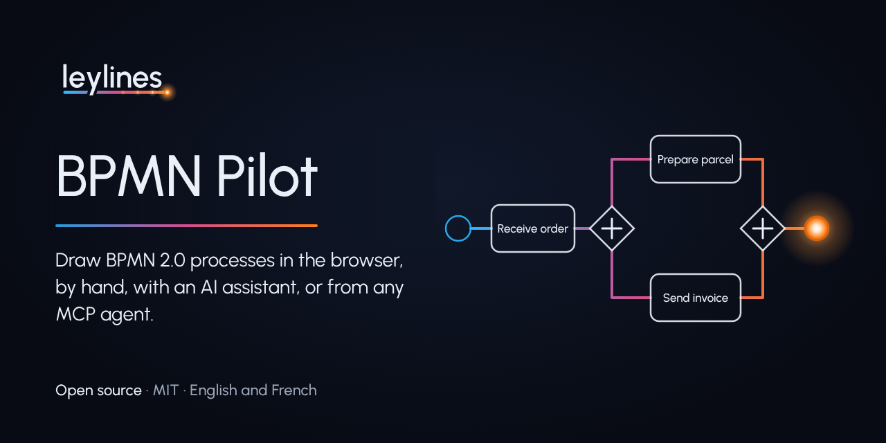
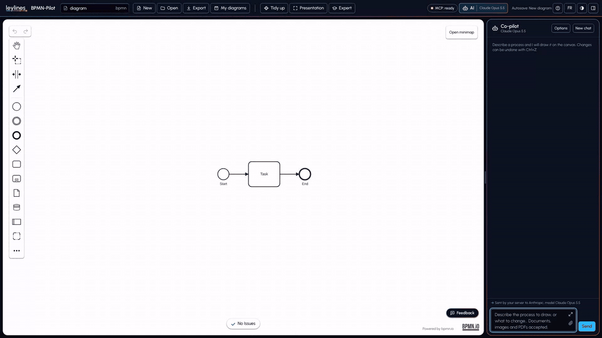

# bpmn-editor

[](https://github.com/Leylines-Prism/bpmn-editor/actions/workflows/ci.yml)
[](https://github.com/Leylines-Prism/bpmn-editor/tags)
[](https://github.com/Leylines-Prism/bpmn-editor/pkgs/container/bpmn-editor)
[](LICENSE)
[](https://scorecard.dev/viewer/?uri=github.com/Leylines-Prism/bpmn-editor)
[](https://www.bestpractices.dev/projects/17089)

**English** | [Français](README.fr.md)



A BPMN 2.0 editor in the browser (bpmn-js), with an AI assistant that draws the processes you
describe, and an MCP server so that agents such as Claude Code can draw in it too. Use it
[online](https://bpmn.leylines.fr), with nothing but a browser, or run it on your own machine with
Docker.

> [!WARNING]
> **Not made to be exposed on the internet, by design.** The Docker version is meant for your own
> machine or a private network, so it has no login. The risk stays limited, but publishing it means
> a service open to anyone without authentication: your API keys can be used or stolen, and the
> diagrams stored in the container (the BPMN files of "My diagrams") can be read or deleted. By
> default it only answers on this machine (`127.0.0.1`). If you put it on the internet anyway, you
> do so at your own risk.

## Run it with Docker

You need [Docker](https://docs.docker.com/get-docker/) with Docker Compose. Two images are published
on the GitHub Container Registry, for amd64 and arm64:

- `ghcr.io/leylines-prism/bpmn-editor`: the editor.
- `ghcr.io/leylines-prism/bpmn-editor-mcp`: its server (AI assistant, MCP for agents, "My diagrams").

### From the command line

```
mkdir bpmn-editor && cd bpmn-editor && mkdir bpmn-data
curl -fsSLO https://raw.githubusercontent.com/Leylines-Prism/bpmn-editor/main/docker-compose.image.yml
docker compose -f docker-compose.image.yml up -d
```

Then open http://localhost:8080. No `curl`? `wget https://raw.githubusercontent.com/Leylines-Prism/bpmn-editor/main/docker-compose.image.yml` does the same.

- **AI assistant**: create a `.env` file in the same folder with your API key (Mistral, Anthropic,
  OpenAI, or a local Ollama), for example `ANTHROPIC_API_KEY=sk-ant-...`, then run the `up -d` command
  again. All the variables are listed in [mcp/.env.example](mcp/.env.example). You can also enter a
  key in the assistant's Options window. Without a key, the editor works; only the assistant is off.
- **Your files** (My diagrams on the server, exports) are in the `bpmn-data` folder, next to
  `docker-compose.image.yml`: see [Your files](#your-files-docker-version).
- **Showcase page**: the logo in the toolbar opens a showcase page with the author's logo and
  wallpapers. To turn it off, add `SHOWCASE=off` to the `.env` file (or the stack's environment
  variables), then run the `up -d` command again. The logo then opens the Feedback window.
- **Update**: change the version number of both images in `docker-compose.image.yml` (see the
  [versions](https://github.com/Leylines-Prism/bpmn-editor/tags)), then:

  ```
  docker compose -f docker-compose.image.yml pull
  docker compose -f docker-compose.image.yml up -d
  ```

### With a container manager

In a tool that deploys Compose stacks (Portainer, for example), create a stack, paste the content of
[docker-compose.image.yml](docker-compose.image.yml), and enter the settings below
(`ANTHROPIC_API_KEY`…) as the stack's environment variables. Set `BPMN_DATA_DIR` to an absolute path
on the host, the folder where you will find your files.

### From the source code

To change the code, or to build the images yourself:

```
git clone https://github.com/Leylines-Prism/bpmn-editor.git
cd bpmn-editor
docker compose up -d --build
```

Here the API keys go in `mcp/.env` (copy `mcp/.env.example`), the other settings in a `.env` file
next to `docker-compose.yml`. **Update**: `git pull`, then `docker compose up -d --build`.

## Your files (Docker version)

Everything the server keeps is in one folder, `bpmn-data`, next to the compose file. Open it with your
file explorer to get your files back:

- `bpmn-data/diagrams`: the diagrams saved on the server with "My diagrams", one `.bpmn` file per
  diagram, named after it (`Order process.bpmn`). Renaming a diagram in the editor renames its file.
  Two diagrams with the same name give `Order process.bpmn` and `Order process (2).bpmn`. The hidden
  `.index.json` file links the files to the editor: leave it in place. A `.bpmn` file you copy into
  this folder appears in My diagrams, under its file name (10 MB at most).
- `bpmn-data/exports`: the exports (.bpmn, .xml, SVG, PNG, PDF), when the **Destination** at the top
  of the Export menu is "Server" or "Both". "Download", the default, only downloads them in the browser, as before.
  An export never replaces a file: a second `Order process.pdf` becomes `Order process (2).pdf`.
  "XML code to copy" and "Print" do not make files and are not concerned.

Where the folder is:

- **Docker Desktop** (Windows, macOS): it is created at the first start, next to the compose file.
- **Linux**: create it before the first start (`mkdir bpmn-data`). The server runs as user 1000,
  without root, so that the files belong to you. If `id -u` and `id -g` give other numbers, add
  `PUID=` and `PGID=` with these numbers to the `.env` file. If the server cannot write in the folder,
  it says so in its log (`docker compose logs mcp`).
- **Elsewhere**: set `BPMN_DATA_DIR` to the path of another folder. In a container manager, always
  give an absolute path.

Security: the files are readable by their owner and group only (0640, folders 0750). The server runs
on a read-only file system except for this folder, without any Linux capability and without privilege
escalation. It only accepts the five export formats, checks that each file matches its format, takes
20 MB at most per export, and cleans file names (no folder, no hidden file, no name reserved by
Windows).

**Coming from an older version**: the diagrams were in a `diagrams` Docker volume, which the new
version no longer uses. Copy them once into the folder, then restart. The volume is named after the
folder of the compose file (`docker volume ls` lists it), here `bpmn-editor_diagrams`:

```
docker run --rm -v bpmn-editor_diagrams:/old:ro -v "$PWD/bpmn-data:/new" alpine:3.22 sh -c 'mkdir -p /new/diagrams && cp -a /old/diagrams/. /new/diagrams/ && chown -R 1000:1000 /new'
```

At the next start, the server renames these files after their diagram.

## Reach it from other machines

The container serves plain HTTP on `127.0.0.1:8080`, for this machine only. To use it from your
other devices, keep it on a private network: [Tailscale Serve](https://tailscale.com/kb/1312/serve),
for example, gives it an HTTPS address that only the machines of your tailnet can reach. Then tell
the editor its new name, in the `.env` file next to the Compose file, and add a token
`MCP_TOKEN=...` (the "Connect an agent" window generates one; from the source code, it goes in
`mcp/.env`):

```
BPMN_EDITOR_ORIGINS=https://bpmn.example.com
MCP_ALLOWED_HOSTS=bpmn.example.com
```

Run `docker compose up -d` again. Other proxies work too: they must pass the `Host` header and allow
WebSocket on `/bridge` (details in [mcp/README.md](mcp/README.md#behind-a-domain-name)).

### On the internet, at your own risk

This project is not designed or tested to be exposed on the internet, and gives no guarantee if you
do it. If you still choose to, put a login in front of the pages and set the token. Here is an
example with [Caddy](https://caddyserver.com/), which gets the certificate for your domain on its
own. Point the domain's DNS to the machine, set the two variables and the token above, then use
this `Caddyfile`:

```
bpmn.example.com {
	# A login for the pages. /mcp is left out: agents use MCP_TOKEN instead.
	@pages not path /mcp
	basic_auth @pages {
		alice <hash given by: caddy hash-password>
	}
	reverse_proxy 127.0.0.1:8080
}
```

Without a proxy login, anyone who finds the address can use the editor and your API keys. A login
and a token reduce the risk, they do not remove it. [Cloudflare Tunnel](https://developers.cloudflare.com/cloudflare-one/connections/connect-networks/)
with Cloudflare Access is another way to put a login in front of it, with no open port.

## Connect an agent (MCP)

Click the **MCP** badge in the toolbar. The "Connect an agent" window gives the address to use
(`http://localhost:8080/mcp`, or `https://your-domain/mcp`), and the setting to paste for Claude
Code, Claude Desktop, GitHub Copilot in VS Code, Cursor or another MCP client. The agent draws in the editor tab used last, so keep it open.

An optional token protects this access: the same window generates one and tells you where to put it.

## Where your API keys are kept

**In the Docker version**, the safest place is the server: the `.env` file next to
`docker-compose.image.yml` (or `mcp/.env` from the source code). The key stays on the server and never
reaches the browser. A key typed in the assistant's Options window is kept in the browser as below,
then sent with each message to your server, which passes it on to the provider without storing it.

**In the browser** (the online version, or keys typed in Options):

- The key stays in your browser, for this site only. Other sites cannot read it.
- "Remember API keys on your device" unchecked (the default): the key is kept in `sessionStorage` and
  is gone when you close the tab.
- Checked: the key is kept in `localStorage` and stays on the device until you click "Clear API keys".
- It is not encrypted. Encrypting it in the browser would not help: the key to decrypt it would have
  to be stored right next to it.
- What protects it: the page runs no script from another site (Content Security Policy), and the key
  is only sent to the provider you chose.
- The limit: a malicious browser extension, or someone using your session on the computer, can read
  it. On a shared computer, leave the box unchecked.

## Settings

All optional. With the published images, put them all in the `.env` file next to
`docker-compose.image.yml`, or in the stack's environment variables, then run the `up -d` command
again. From the source code, put them in a `.env` file next to `docker-compose.yml` (git ignores
it), unless the table says `mcp/.env`, then run `docker compose up -d --build`.

| Setting | What it does |
|---|---|
| `MISTRAL_API_KEY`, `ANTHROPIC_API_KEY`, `OPENAI_API_KEY`… (`mcp/.env`) | API keys for the AI assistant. See `mcp/.env.example`. |
| `MCP_TOKEN` (`mcp/.env`) | Token that agents must send. The "Connect an agent" window generates one. |
| `BPMN_PORT` | Port of the site (8080 by default). |
| `BPMN_EDITOR_ORIGINS`, `MCP_ALLOWED_HOSTS` | The address and name of the site when it is served under a domain name (see above). |
| `BPMN_BIND` | Network interface the site listens on (`127.0.0.1` by default). `0.0.0.0` opens it to your network, without HTTPS. |
| `BPMN_DATA_DIR` | Folder of the server files, My diagrams and exports (`./bpmn-data` by default). |
| `PUID`, `PGID` | User and group the server runs as, owners of its files (1000 by default). |
| `SHOWCASE` | `off` turns off the showcase page (`about.html`) and its wallpapers. The logo in the toolbar then opens the Feedback window. `on` by default. |

## What the editor does

- **Files**: name, new, open (file, pasted XML, or drop), export (.bpmn, .xml, SVG, PNG, PDF), copy
  as an image, print the diagram alone fitted to one page. The current diagram is restored when you
  come back.
- **My diagrams**: save several diagrams, reopen, rename, delete. Ctrl+S saves.
- **Drawing**: palette, context pad, copy and paste, tidy up, token simulation, BPMN rule checking,
  grid, minimap, and the Process panel for the properties of each element.
- **Colors and text**: any fill, stroke or text color, from ready-made palettes or the system color
  picker, and text formatting (bold, italic, underline, size, font, "Auto" for readable text on dark
  fills). The Process panel copies a style onto other elements and reuses those already in the
  diagram in one click.
- **AI assistant**: describe a process and it draws it, in your language. You can paste or drop
  images and PDF files. The model is chosen in Options. What it adds or changes is outlined on the
  canvas, and a pill sums up the changes.
- **Interface**: light or dark theme, English or French, resizable side panels. Made for a computer
  screen: on a phone, it is mostly for viewing a diagram.

## How it differs from draw.io or Lucidchart

They are great for drawing almost anything, as a team. This editor only does BPMN 2.0, on top of
[bpmn-js](https://github.com/bpmn-io/bpmn-js): a diagram is a real BPMN model, so the .bpmn file
opens in other BPMN tools, can be checked and simulated, and what the AI draws is valid BPMN too. It
has no real-time collaboration, share link or templates, though.

## Use it online

The editor is open to everyone at https://bpmn.leylines.fr (GitHub Pages): no account, nothing to
install, just a browser. Its [user guide](https://bpmn.leylines.fr/help.html) explains how to draw,
save, export and use the AI assistant. The Help (?) button in the toolbar opens it too.

It comes in two pages. The root follows the released versions (the latest `vX.Y.Z` tag), and
https://bpmn.leylines.fr/dev/ follows the main branch, with the latest changes before they are released.
The development page keeps its own diagrams and settings in the browser, so trying it does not touch
those of the stable page. Both show their version at the bottom of Options and of the user guide.

For the AI assistant, each visitor enters their own API key, which stays in their browser.
Compared with the Docker version, there is no agent connection (MCP) and no saving on a server, and
some providers (OpenAI) refuse calls from a web page. The "Privacy" link on the page says what leaves the browser.

The stable page measures its audience without cookies, with [Umami](https://umami.is): visits, referrers and a few actions (assistant opened or used, provider connected, diagram
created, opened or exported, active time by range, support link clicked). No third-party script is loaded: the page sends
these measurements itself ([src/analytics.js](src/analytics.js)), never the content of diagrams,
messages or API keys. "Do Not Track" and "Global Privacy Control" turn measurement off, and
`localStorage.setItem('umami.disabled', '1')` in the console excludes your own visits. Neither the
Docker image nor `npm run dev` measure anything. The measurement is configured according to the recommendations of the
CNIL (the French data protection authority) for audience measurement exempt from consent.

## Development

`npm install`, then `npm run dev` for the editor, and `npm start` in `mcp/` for the server.
Details on the server, the assistant and the MCP tools: [mcp/README.md](mcp/README.md).
`npm run build:online` builds the online version as a static site in `dist-online/` (`BASE_PATH` sets its path). Audience measurement is turned on by the GitHub variables `VITE_UMAMI_URL` (Umami address)
and `VITE_UMAMI_WEBSITE_ID` (site ID): without them, nothing is sent.
The site is published by [.github/workflows/pages.yml](.github/workflows/pages.yml) on each change to `main`.

## About this project

This is a personal project, maintained in spare time, and **every contribution is welcome**: bug
reports, ideas, translations, documentation or code. If you feel like helping it grow, please do.

In full transparency: its author is not a professional developer. The editor is built with AI
assistance, using Claude Code and other AI models, and each change is tried in the browser before
it is published. Reviews from experienced developers are especially appreciated.

**Testers wanted for AI providers.** The assistant is tried day to day with Anthropic models only.
Mistral, OpenAI, Ollama and OpenAI-compatible servers are supported from their documentation, but
rarely tried for real. If you use one of them, any report helps, whether it works or not: open an
[issue](https://github.com/Leylines-Prism/bpmn-editor/issues) or a
[discussion](https://github.com/Leylines-Prism/bpmn-editor/discussions) with the provider, the model
and what you tried (drawing, images, PDF files).

Start with [CONTRIBUTING.md](CONTRIBUTING.md). Questions and ideas go to
[Discussions](https://github.com/Leylines-Prism/bpmn-editor/discussions), bugs to the
[issues](https://github.com/Leylines-Prism/bpmn-editor/issues), and security problems to the private
form described in [SECURITY.md](SECURITY.md). There is no guaranteed response time, but everything
is read.

If the editor is useful to you, you can support the project with a coffee on
[Ko-fi](https://ko-fi.com/leylines_prism).

## License

The code is released under the [MIT License](LICENSE).

The Leylines name, logo and brand assets (the files in [src/brand/](src/brand/) and
the logo drawn by [src/theme/brand-logo.js](src/theme/brand-logo.js)) are not covered by this
license. If you publish your own version, replace them with your own.

The editor is built on [bpmn-js](https://github.com/bpmn-io/bpmn-js), whose license requires the
bpmn.io watermark to stay fully visible on the canvas. Keep it if you change the layout.
